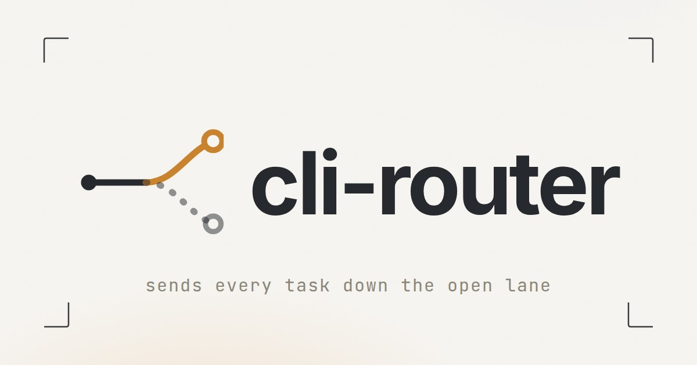
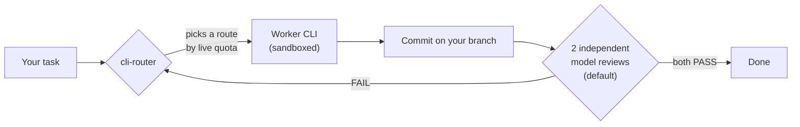

<p align="center">
  
</p>

<p align="center">
  [](LICENSE)
  
  <a href="https://github.com/marcosconci1/cli-router/actions/workflows/tests.yml"></a>
</p>

<p align="center">
  <b>Route coding tasks across AI CLIs by live quota, with two independent reviews by default.</b> cli-router brings this capability to Hermes Agent. Submit a coding task, and the AI CLI with real quota room builds it, commits it on your branch, and passes two independent reviews by default before it is done.
</p>


Developers who use AI coding CLIs manage several subscriptions at once. Each CLI has its own usage limit, and the limits reset on different schedules. Someone has to track them. When the CLI in use hits its limit in the middle of a task, the person switches tools by hand, restarts the task, and explains the context again. While one subscription is exhausted, the others sit idle.

cli-router is a plugin for [Hermes Agent](https://github.com/NousResearch/hermes-agent) that takes over this work. You submit one task. The router reads live usage windows from every configured CLI, keeps a reserve, and picks the one with room. The chosen CLI runs with sandbox write controls and commits the result on your branch. The bubblewrap sandbox leaves host files readable except for masked paths, and network access remains open; see [the sandbox contract](docs/sandbox.md). By default, before the change counts as done, two distinct models in fresh contexts and separate disposable snapshots review it independently. Models may share a provider. A review that fails sends the task back with the required changes.

Work spreads across the installed accounts so no single account absorbs everything, within each provider's terms of service; tasks keep moving when a quota window closes, and by default every change lands with a second opinion recorded in the task history.



## How it picks a route

* Reads real usage windows from each provider, keeps a 20% reserve when usage is known, and never picks a route that is about to hit its limit.
* Ranks candidates by a public coding benchmark index. No extra service needed.
* Ranking works without Jev. Jev can rank with a live LLM call; when enabled it assesses retry handoffs. A per-install config can disable Jev and use deterministic ranking and progress-based retry continuation.
* By default, two distinct models in fresh contexts and separate disposable snapshots review a change before it counts as done. The review can be switched off in `cli-router.yaml`; local acceptance checks still run and the task record shows the review as skipped.

## Quick start

```bash
hermes plugins install marcosconci1/cli-router
```

Enable it in your profile `config.yaml`:

For retry handoff, also add the `entries` settings block (`routing.providers` and `connection`) shown in [the install guide](docs/install.md#enable-it).

```yaml
plugins:
  enabled:
    - cli-router

platform_toolsets:
  discord:
    - cli_router
```

Restart the gateway, then ask Hermes to route a task:

```json
{"action": "submit", "mode": "change", "repository": "/path/to/repo",
 "task": "Fix the failing test in tests/api.py",
 "acceptance_criteria": [{"type": "python_compiles", "path": "app.py"}]}
```

Poll with `{"action": "wait", "task_id": "<id>"}` until it reports completed; `route` and `routes_used` show which CLI and model are running or have run.

You can pin the worker to one CLI or model by adding `"cli": "claude"` or
`"model": "claude-opus-5-5"` to the submit call. The pin narrows the routing
to that route and skips automatic ranking; the independent reviews still pick
their own models. A pin that matches nothing is refused at submit with the
list of installed options.

## Requirements

* Linux with bubblewrap (`bwrap`), Git, and `systemd-run`.
* At least one authenticated provider CLI (`codex`, `kimi`, `agy`, `claude`, or `opencode`).
* Optional: an ai-memory CLI and server for managed cross-attempt memory and ledger-confirmed reviews.

## Optional ai-memory integration

Set `ai-memory: enabled | disabled | auto` in the `cli-router` settings in your Hermes profile. The default is `auto`: cli-router uses managed ai-memory when it is available and runs standalone when it is not. `enabled` requires managed ai-memory; `disabled` always runs standalone.

Standalone runs invoke the CLI directly and reviews run without ledger confirmation. Standalone mode has no cross-attempt handoff memory and allows only one worker attempt per task.

## Per-install configuration

Copy `cli-router.example.yaml` from the installed plugin directory to `<hermes-home>/cli-router.yaml`,
the Hermes home of the active profile (for a code profile, typically `~/.hermes/profiles/<name>/`).
The Hermes home is outside the plugin directory, so reinstalling or updating the plugin does not
touch it. `CLI_ROUTER_CONFIG` can override the path; the plugin-directory file remains a legacy
fallback. The file controls providers and exact per-CLI model exclusions, Jev, ai-memory, independent
review, and the worker limit. See [Configuration](docs/configuration.md) for precedence, setup, and
supported YAML syntax.

## Documentation

* [Installation](docs/install.md)
* [Configuration](docs/configuration.md)
* [Quota behavior](docs/quota.md)
* [The sandbox](docs/sandbox.md)
* [Wiki: how it is built](wiki/Home.md)
* Run `python3 doctor.py` to check your machine; the `diagnose` action writes a local, redacted diagnostic bundle (no telemetry, no network) for bug reports.

This tool is not affiliated with Anthropic, OpenAI, Moonshot AI or Google. It reads the locally stored credentials of the provider CLIs installed on your machine to report quota. You are responsible for complying with each provider's terms of service.

## License

MIT. The vendored quota fetchers under `quota_providers/` are adapted from [rarf/hermes-quota-plugin](https://github.com/rarf/hermes-quota-plugin) (MIT). The benchmark index in `benchmarks/` is public data from [Akita's LLM benchmark post](https://akitaonrails.com/2026/10/28/llm-benchmark-v4-gemini-4-argon-gpt-sol-6-1-terra-kimi-k3-1-pro-claude-sonnet-5-5/).
